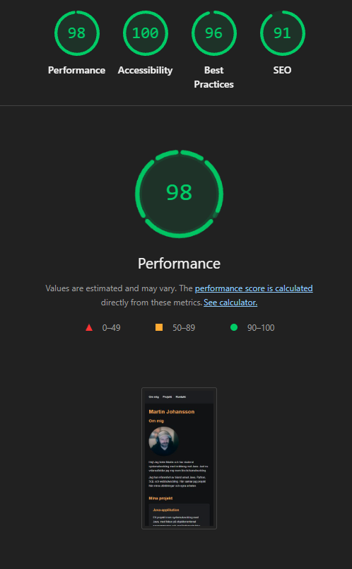
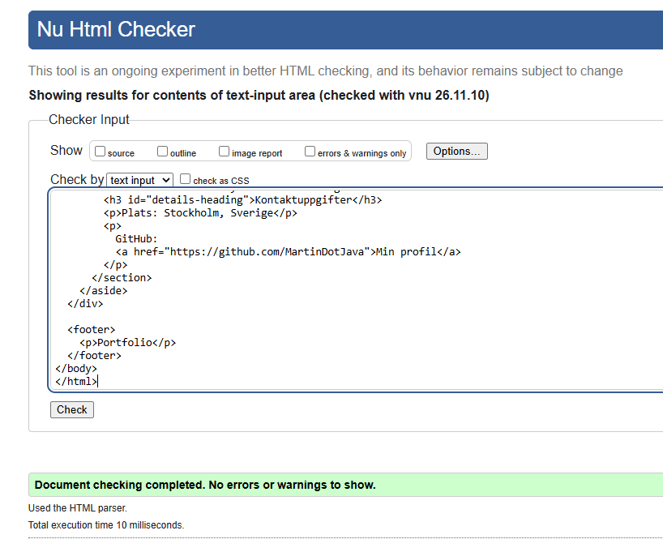
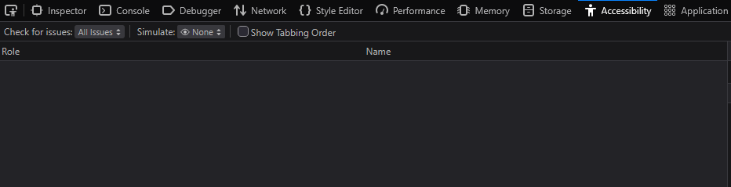

# Portfolio

En personlig portfolio byggd med HTML och CSS som en del av
min utbildning inom blockchainutveckling.

Sidan innehåller en kort presentation av mig, information
om mina tekniska kunskaper, tidigare projekt och ett
kontaktformulär.

## Tekniker

- HTML5
- CSS3
- CSS Grid
- Flexbox
- Git och GitHub

## Funktioner

- Responsiv layout för mobil, surfplatta och desktop
- Tre projekt med beskrivningar
- Kontaktformulär med HTML-validering
- Semantisk HTML
- Tangentbordsnavigering och tydliga fokusmarkeringar

Kontaktformuläret är en demonstration och skickar
inga meddelanden.

## Köra projektet lokalt

1. Klona repositoryt från GitHub.
2. Öppna projektmappen.
3. Öppna `index.html` i en webbläsare.

Projektet kräver inga externa bibliotek eller installationer.

## Tillgänglighetsgranskning

Webbplatsen har granskats med följande verktyg:

### Chrome Lighthouse

Test utfört i mobilläge.

- Performance: 98
- Accessibility: 100
- Best Practices: 96
- SEO: 91

### W3C HTML Validator

HTML-dokumentet validerades utan fel eller varningar.

- Errors: 0
- Warnings: 0

### Firefox Accessibility Tools

Kontroll genomförd med Firefox Accessibility Tools.
Inga problem visades i verktygets resultatpanel.
Panelen var dock tom, så resultatet kunde inte
bekräftas som en fullständig granskning.

## Utvecklare

Martin Johansson

GitHub: https://github.com/MartinDotJava

## Webbplats

https://martindotjava.github.io/portfolio/
